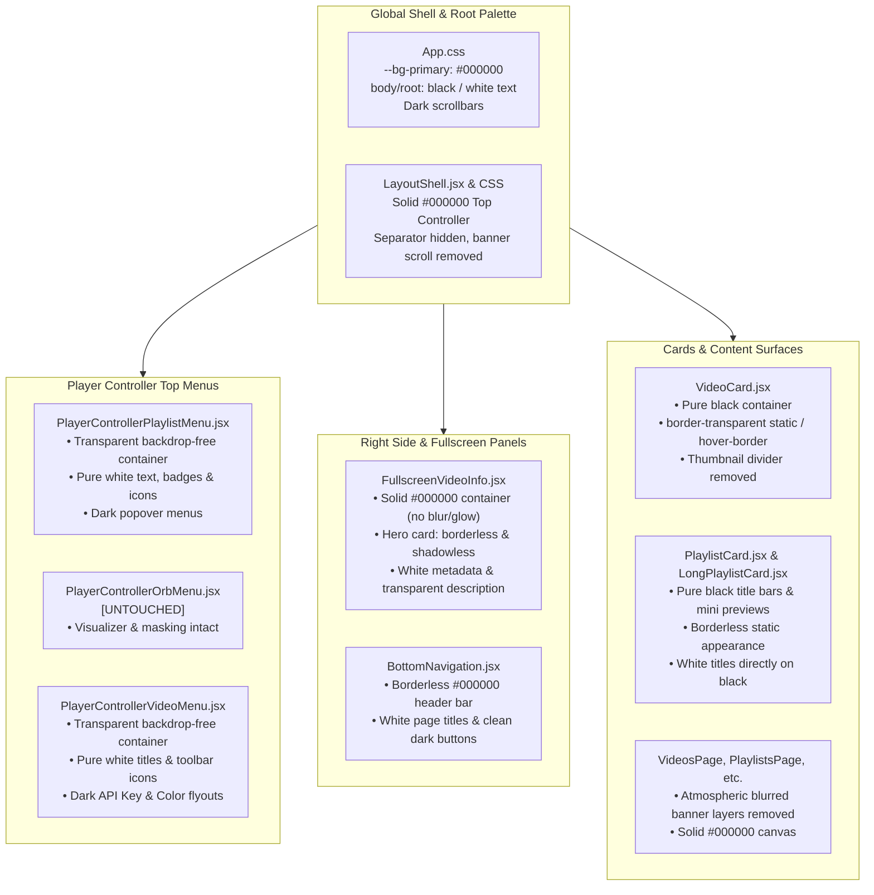

# Session Update: October 25, 2026 — Pure Black Dark Mode Refactor

This document serves as the architectural record and handoff guide for the comprehensive dark mode aesthetic refactor implemented across the application.

---

## 1. Executive Summary & Goals

The application was transitioned from the legacy light "Cool Blue" (`#e0f2fe`, `bg-slate-100`, `#052F4A` navy) aesthetic to a high-performance, minimalist **pure black (`#000000`) dark mode**.

### Key Objectives Achieved:
1. **Performance Optimization via Banner Pruning**:
   - Eliminated the performance-heavy dynamic disk banner lookups, real-time background calculations, and infinite scroll CSS animations.
   - Removed the "Atmospheric Blurred Banner System" (`filter: blur(36px)`) across all main page backgrounds (`VideosPage`, `PlaylistsPage`, `HistoryPage`, `LikesPage`, `PinsPage`), resolving GPU and memory overhead.
2. **Backdrop-Free Minimalist UI**:
   - Replaced card backdrops, grey container boxes, and blue tints with pure `#000000` backgrounds.
   - Text, titles, and action icons rendered in crisp `#ffffff` floating cleanly over the black surface.
3. **Static Border & Divider Purge**:
   - Stripped all static, persistent outlines (`border-white/10`, `border-white/20`, `border-slate-700/40`) and horizontal dividing lines so UI elements blend seamlessly into the black background.
   - Retained interactive hover states (`hover:border-white/30`, `hover:ring-2`) for responsive tactile feedback.
4. **Strict Scope Protection**:
   - **Central Orb customizability remains 100% intact**: visualizer styles, canvas rendering, SVG spillover masking, orbital crops, and orb presets were untouched.

---

## 2. Architectural Blueprint

---

## 3. Component & File Changes Manifest

### 3.1 Global Root & Shell
- **`src/App.css`**:
  - Root CSS variables updated to `--bg-primary: #000000;`, `--bg-secondary: #0a0a0a;`, `--bg-tertiary: #141414;`, `--border-color: rgba(255, 255, 255, 0.1);`.
  - Body and document root set to `background: #000000; color: #ffffff;`.
  - Scrollbars styled with dark rectangular tracks (`#000000`) and subtle diagonal-stripe thumbs (`#334155`).
- **`src/LayoutShell.jsx`**:
  - Removed dynamic disk banner rendering (`renderHalfBanner`), calculations, and preview overrides.
  - Removed vestigial `playerBorderPattern` class from the main player slot.
  - Top controller container hardcoded to solid `#000000`.
- **`src/LayoutShell.css`**:
  - `.layout-shell__top-controller`: Set to `background-color: #000000; border-bottom: none;`.
  - `.layout-shell__separator`: Set to `display: none;`.
  - `.layout-shell__banner-bg`: Set to `display: none;`.

### 3.2 Player Controller Top Menus
- **`src/components/PlayerControllerPlaylistMenu.jsx`**:
  - Removed the `bg-slate-100 border-2 border-[#052F4A]` backdrop `div`.
  - Card container set to `bg-transparent` without borders or shadows.
  - Playlist title and badges styled with pure white typography (`text-white font-black`).
  - Chevron, clock, plus, and library icons updated to clean `#ffffff`.
  - Dropdown popovers ("Add Menu", "More Options") styled in dark mode (`bg-black/95 border border-white/20 text-white`).
- **`src/components/PlayerControllerVideoMenu.jsx`**:
  - Removed the `bg-slate-100 border-2 border-[#052F4A]` backdrop `div`.
  - Card container set to `bg-transparent`.
  - Video title updated to pure white.
  - Navigation chevrons, grid button, play button, star, and toolbar action icons updated to `#ffffff`.
  - YouTube API key flyout and accent color picker wrapper updated to dark styling (`bg-black/90 border border-white/20`).
- **`src/components/PlayerControllerOrbMenu.jsx`**:
  - **Untouched**: Retained all existing visualizer styles, canvas logic, SVG partial spillover masking, orbital crop handling, and preset routing.

### 3.3 Fullscreen Video Info Panel
- **`src/components/FullscreenVideoInfo.jsx`**:
  - Removed the `blurredBannerStyle` layer and blurred backdrop elements.
  - Container hardcoded to solid black (`bg-black`, `#000000`).
  - Hero Video Metadata Card converted to borderless and shadowless (`border-0 shadow-none bg-black`).
  - Removed static horizontal divider line (`
`).
  - Removed avatar border (`border-0`) and YouTube external button static outline (`border-transparent hover:border-white/20`).
  - Integrated description box converted to `border-0 bg-transparent`.
  - Thumbnail container converted to `border-0 shadow-none`.

### 3.4 Cards & Navigation
- **`src/components/VideoCard.jsx`**:
  - Removed white bottom bar container (`bg-white dark:bg-slate-800`).
  - Card container updated to `bg-black border border-transparent hover:border-white/30 shadow-none`.
  - Removed thumbnail bottom divider line (`border-b border-white/10`).
- **`src/components/LongPlaylistCard.jsx`**:
  - Top header bar converted to `bg-black border border-transparent hover:border-white/20 shadow-none`.
  - 4-video mini-card previews converted to `bg-black border border-transparent hover:border-white/30` with `text-white font-bold`.
  - Removed mini thumbnail bottom divider line (`border-b border-white/10`).
  - Skeleton loading slots and empty placeholders converted to borderless / dark borders.
- **`src/components/PlaylistCard.jsx`**:
  - Large title bar converted from `border border-white/10` to `border-0 shadow-none`.
  - Mini preview items converted from `border border-white/20` to `border border-transparent hover:border-white/50 shadow-none`.
- **`src/components/BottomNavigation.jsx` & `TopNavigation.jsx`**:
  - Stripped `border border-white/10 shadow-md` outline from `BottomNavigation.jsx` (`border-0 shadow-none`).
  - Converted action buttons to `border-transparent hover:border-white/20 bg-zinc-900/60 hover:bg-zinc-800`.
  - Stripped dynamic menu border variables in `TopNavigation.jsx` (`border-0`).

### 3.5 Atmospheric Banner Purge Across Pages
- **`VideosPage.jsx`**, **`PlaylistsPage.jsx`**, **`HistoryPage.jsx`**, **`LikesPage.jsx`**, **`PinsPage.jsx`**:
  - Removed the atmospheric blurred banner background layers (`filter: blur(36px)` / `backgroundImage: url(${bannerImage})`).
  - Converted page root containers from `bg-slate-950` to solid `bg-black`.

---

## 4. Verification & Testing

- **Compilation**: Full production build tested via Vite (`npm run build`).
  - Result: 2265 modules transformed cleanly in ~4.08s with 0 errors.
- **Visual Inspection**:
  - No light card shells or navy `#052F4A` text remain in the primary UI paths.
  - Surfaces merge into `#000000` without visible grey border lines.
  - Hover states on video cards and playlist cards function as intended.
